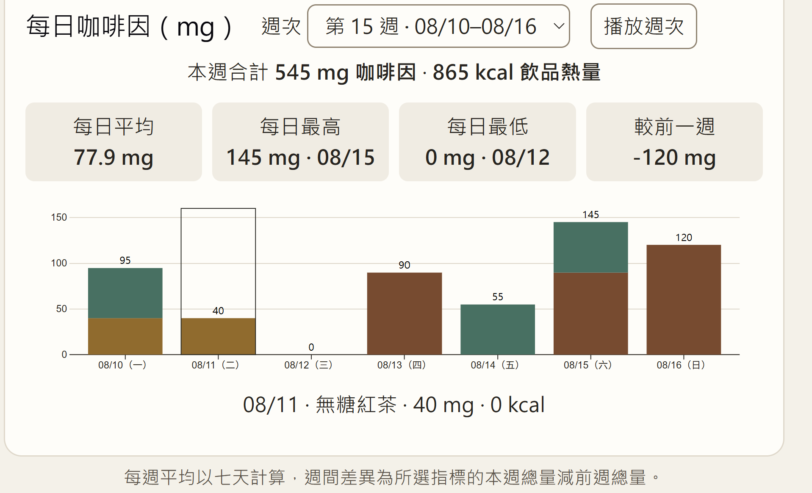
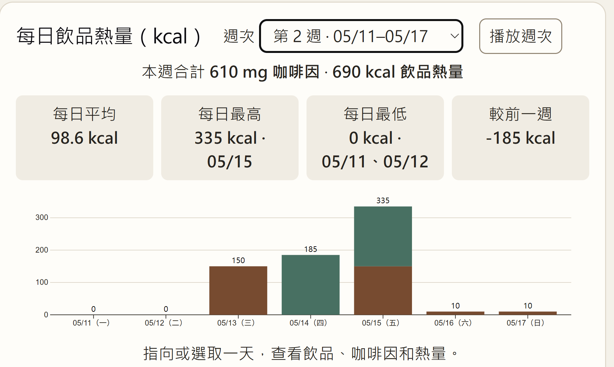

# 1151VIS HW2 — Dynamic Visualization using D3.js

## 專題名稱

半年飲品攝取觀察｜咖啡因與飲品熱量

## 專案簡介

本專案延伸 HW1 的每日咖啡因長條圖，使用 StackBlitz、Vue、Vite 與 D3.js 製作互動視覺化。觀察區間為 2026/05/04–2026/11/01，共 26 週、182 天。飲品品項和數值均為模擬資料，熱量僅計入飲品。

## 專案截圖

### 26 週咖啡因總覽

### 第 1 週每日明細

### 第 2 週飲品熱量與週間差異

## 專案與影片連結

- [GitHub Repository](https://github.com/mitesoro1231/1151VIS-HW2-410262690-YushuanChen)
- [YouTube 操作影片](https://youtu.be/qY8dDYTXIns)

## 製作流程

1. 在 StackBlitz 建立 Vue＋Vite 專案，安裝 D3.js。
2. 建立 182 天的模擬飲品紀錄，依日期、飲品來源、咖啡因與熱量整理資料。
3. 以 D3.js 繪製每週總量和每日明細的堆疊長條圖，用顏色區分咖啡、茶和抹茶。
4. 依選定指標計算每日平均、最高與最低值，並以本週總量減去前一週總量計算週間差異。
5. 加入指標切換、飲品篩選、週次播放與長條更新動畫。

## 操作方式

1. 在「指標」選擇咖啡因（mg）或飲品熱量（kcal）。
2. 在「飲品來源」選擇全部、咖啡、茶或抹茶。
3. 點選上圖的長條，或使用週次下拉選單，查看該週的每日明細與統計。
4. 將滑鼠移到每日長條上，查看當天的飲品、咖啡因與熱量。
5. 按「播放週次」自動切換，按「暫停」停在目前週次。
